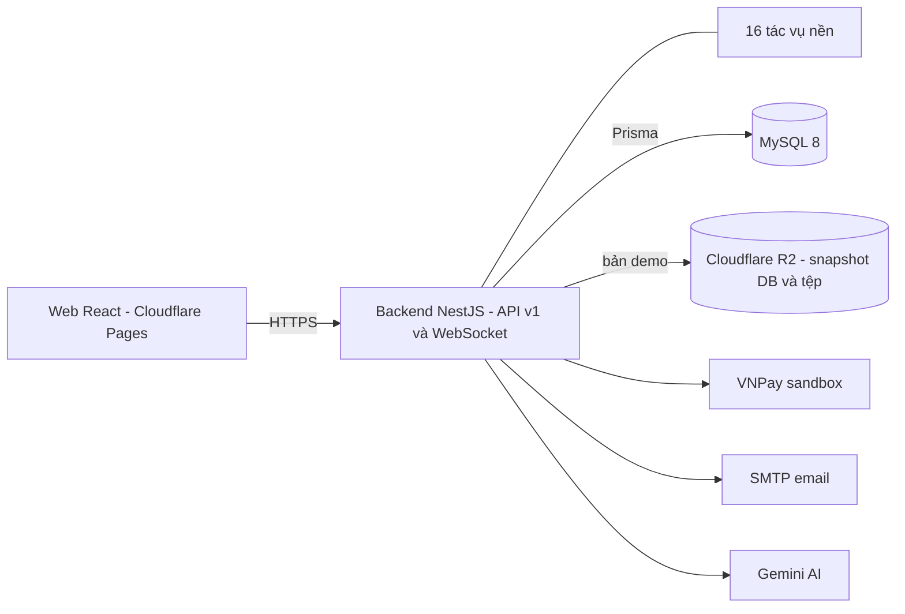

# VAULTRA — Hệ thống cho thuê và quản lý kho tự quản

**Self-Storage Facility Rental and Management System.**
Khách tìm kho đúng kích thước, đặt và thanh toán trực tuyến; cơ sở bàn giao có ký hợp đồng điện tử, biên bản hiện trạng và mã PIN; doanh nghiệp quản lý chính sách, giá, công nợ và doanh thu trên cùng một dữ liệu.

| | |
|---|---|
| Giao diện (bản chạy thử) | <https://vaultra-844.pages.dev> |
| Mã nguồn | <https://github.com/duykhangt1/vaultra> |
| Tài liệu | [Hướng dẫn demo 7 luồng](docs/DEMO_GUIDE.md) · [Tài liệu bảo vệ đồ án (PDF)](docs/VAULTRA_PROJECT_DEFENSE_GUIDE.pdf) · [Hướng dẫn demo (PDF)](docs/HUONG_DAN_DEMO_7_FLOW_VAULTRA.pdf) · [Truy vết yêu cầu](docs/TRACEABILITY.md) · [Đánh giá UX](docs/UX_AUDIT.md) · [Báo cáo kiểm tra](AUDIT_REPORT.md) · [Hệ thống thiết kế](DESIGN_SYSTEM.md) |

---

## Mục lục

1. [Tổng quan](#1-tổng-quan)
2. [Tính năng chính](#2-tính-năng-chính)
3. [Vai trò và phân quyền](#3-vai-trò-và-phân-quyền)
4. [Bảy quy trình nghiệp vụ](#4-bảy-quy-trình-nghiệp-vụ)
5. [Kiến trúc hệ thống](#5-kiến-trúc-hệ-thống)
6. [Công nghệ sử dụng](#6-công-nghệ-sử-dụng)
7. [Cấu trúc repo](#7-cấu-trúc-repo)
8. [Cài đặt và chạy](#8-cài-đặt-và-chạy)
9. [Biến môi trường](#9-biến-môi-trường)
10. [Tài khoản demo](#10-tài-khoản-demo)
11. [Thanh toán VNPay (sandbox)](#11-thanh-toán-vnpay-sandbox)
12. [Kiểm thử](#12-kiểm-thử)
13. [Triển khai](#13-triển-khai)
14. [Bảo mật](#14-bảo-mật)
15. [Quy tắc nghiệp vụ chính](#15-quy-tắc-nghiệp-vụ-chính)
16. [Giới hạn đã biết](#16-giới-hạn-đã-biết)
17. [Xử lý sự cố thường gặp](#17-xử-lý-sự-cố-thường-gặp)
18. [Giấy phép và nguồn ảnh](#18-giấy-phép-và-nguồn-ảnh)

---

## 1. Tổng quan

Vaultra giải quyết trọn vòng đời thuê một kho tự quản:

```
Tìm kho & đặt chỗ → Thanh toán → Check-in & ký hợp đồng → Sử dụng (PIN, hóa đơn, hỗ trợ)
        → Gia hạn / xử lý quá hạn → Trả kho & quyết toán cọc
```

Điểm khác biệt:

- **Một nguồn dữ liệu cho mọi vai trò:** khách, nhân viên, quản lý cơ sở, quản lý vận hành và quản trị hệ thống cùng làm việc trên một hệ thống, mỗi vai trò một khu giao diện riêng.
- **Tiền truy vết được từ đầu đến cuối:** hóa đơn → thanh toán → phân bổ → hoàn tiền → sổ cái khách hàng.
- **Quy tắc kinh doanh là tham số có phiên bản,** không nằm cứng trong mã; hợp đồng đã ký giữ nguyên chính sách lúc ký (không hồi tố).
- **Phân quyền ở backend** theo vai trò × phạm vi (`OWN` / `FACILITY` / `GLOBAL`), không chỉ ẩn nút ở giao diện.

Quy mô: **5 vai trò · 53 quyền · khoảng 320 endpoint · 104 bảng · 16 tác vụ nền · hơn 100 mẫu thông báo**.

## 2. Tính năng chính

**Dành cho khách thuê**
- Tìm cơ sở trên bản đồ, xem kho còn trống theo kích thước, lịch trống 8 tuần tới, bảng giá kèm VAT và tiền cọc.
- Đặt chỗ có giữ kho **15 phút**, thanh toán qua VNPay hoặc tại quầy, chọn lịch hẹn nhận kho.
- Ký hợp đồng điện tử (chữ ký vẽ tay + OTP email hoặc liên kết ký trong email), tải hợp đồng PDF kèm mã băm SHA-256.
- Xem mã PIN, hóa đơn, lịch sử thanh toán, gia hạn, báo trả kho, gửi yêu cầu hỗ trợ, trò chuyện với trợ lý AI.

**Dành cho nhân viên và quản lý cơ sở**
- Quét mã đơn, check-in 4 bước (rà soát giấy tờ → gán kho → ký hợp đồng → biên bản hiện trạng & cấp PIN).
- Sơ đồ mặt bằng theo khu: xem trạng thái kho thời gian thực, kéo thả và chỉnh bố cục, tạo kho đơn lẻ hoặc hàng loạt.
- Lịch ca, đổi ca, công việc tự sinh và tự giao theo ca, bảo trì, phiếu hỗ trợ có SLA.
- Công nợ: ghi nhận liên hệ, hẹn trả, khóa chặn kho, đề xuất thu hồi, kiểm kê tài sản tồn đọng.

**Dành cho quản lý vận hành và quản trị**
- Chính sách có phiên bản, khung giá, phụ phí, khuyến mãi, phê duyệt hoàn tiền/miễn phí/đổi giá, đối soát thanh toán, báo cáo doanh thu và công nợ (CSV/XLSX/PDF).
- Quản lý tài khoản, ma trận phân quyền, nhật ký kiểm toán, phiên đăng nhập, chặn IP, cấu hình hệ thống, tri thức cho trợ lý AI.

**Nền tảng**
- Thông báo trong ứng dụng và email, cập nhật thời gian thực qua WebSocket.
- Trợ lý AI (Gemini + kho tri thức RAG), có phương án dự phòng khi không có khóa.
- Giao diện tiếng Việt, hỗ trợ tiếng Anh, thiết kế đáp ứng cho điện thoại.

## 3. Vai trò và phân quyền

| Vai trò | Khu giao diện | Phạm vi dữ liệu |
|---|---|---|
| Khách thuê | `/app` | Chỉ dữ liệu của chính mình (`OWN`) |
| Nhân viên cơ sở | `/staff` | Cơ sở được phân công (`FACILITY`) |
| Quản lý cơ sở | `/manage` | Cơ sở được phân công (`FACILITY`) |
| Quản lý vận hành doanh nghiệp (BOM) | `/ops` | Toàn hệ thống (`GLOBAL`) |
| Quản trị hệ thống | `/admin` | Toàn hệ thống (`GLOBAL`) |

- Quyền được kiểm tra ở backend cho từng endpoint; truy cập ngoài phạm vi trả về "không tìm thấy".
- Ma trận quyền xem và chỉnh được tại **Quản trị → Vai trò & quyền** (thêm quyền mới, chỉnh phạm vi từng vai trò).
- BOM có thêm tab **Tài khoản** nhưng bị giới hạn ở backend: chỉ mời và gán quản lý/nhân viên cơ sở, không chạm tài khoản quản trị hay BOM khác.

## 4. Bảy quy trình nghiệp vụ

| # | Quy trình | Tóm tắt |
|---|---|---|
| 1 | **Đặt kho** | Chọn cơ sở, loại kho, ngày bắt đầu, thời hạn, khuyến mãi → báo giá → giữ chỗ 15 phút → thanh toán → đơn "Đã xác nhận". 100 yêu cầu đồng thời cho kho cuối cùng chỉ 1 thành công. |
| 2 | **Check-in & bàn giao** | Nhân viên quét mã đơn, rà soát giấy tờ (kèm ảnh CCCD theo từng đơn), gán kho (đổi kho tính chênh lệch hoặc hoàn tiền), khách ký, lập biên bản ≥ 4 ảnh, cấp mã PIN. |
| 3 | **Quản lý kho đang thuê & trả kho** | Khách xem hợp đồng, PIN, hóa đơn; báo trả kho (báo trước theo chính sách); nhân viên kiểm tra, quản lý duyệt phí hư hại; quyết toán cọc có thời hạn khiếu nại. |
| 4 | **Chính sách, phí, doanh thu** | BOM tạo bản nháp chính sách, xem tác động, xuất bản; quản lý khung giá, phụ phí, khuyến mãi; FM đề xuất phụ phí/miễn phí trong hạn mức, vượt hạn mức chuyển BOM duyệt. |
| 5 | **Cơ sở & nhân sự** | Tạo cơ sở (bản đồ, ảnh, giờ làm việc), khu, loại kho, kho, sơ đồ; lịch ca, đổi ca, công việc, bảo trì. |
| 6 | **Gia hạn & xử lý quá hạn** | Cửa sổ gia hạn tự mở; quá hạn thanh toán đi qua chuỗi: ân hạn → trễ hạn (phí trễ) → khóa truy cập → thông báo cuối → chờ chấm dứt. Không bước nào tự hủy hợp đồng. |
| 7 | **Hỗ trợ & sự cố** | Phiếu hỗ trợ có SLA theo giờ làm việc, tự giao, leo thang lên quản lý cơ sở/BOM, đánh giá sao, mở lại trong 7 ngày. |

Hướng dẫn thao tác từng bước và kịch bản trình bày nằm trong [docs/DEMO_GUIDE.md](docs/DEMO_GUIDE.md).

## 5. Kiến trúc hệ thống



*Backend là một mã nguồn NestJS duy nhất, chạy được theo ba cách (bảng bên dưới).*

Cùng một mã nghiệp vụ (`apps/api`) chạy theo ba cách:

| Chế độ | Dữ liệu | Khi nào dùng |
|---|---|---|
| **Đầy đủ (Node + MySQL)** | MySQL 8 qua Prisma | Phát triển, chạy thật, chạy bộ e2e |
| **Backend cục bộ nối R2** | Bộ nhớ + snapshot lưu trên Cloudflare R2, mở đường hầm HTTPS (Cloudflare Tunnel) và tự công bố địa chỉ lên R2 để giao diện tự tìm thấy | Demo công khai chạy trên máy cá nhân hoặc VPS |
| **Cloudflare Worker (gateway)** | Bộ nhớ + snapshot R2, khóa ghi chung bằng Durable Object, cron 5 phút | Bản demo không cần máy chủ riêng |

Giao diện tìm backend theo thứ tự: biến `window.__VAULTRA_BACKEND_ORIGIN__` → `VITE_API_ORIGIN` → `127.0.0.1:4000` khi chạy cục bộ → địa chỉ lưu trên R2 (`_config/backend-origin.js`).

Điểm chính trong thiết kế:
- **Chống giao một kho cho hai người:** khóa hàng khi đặt và ràng buộc `UNIQUE` ở cơ sở dữ liệu.
- **Chống ghi trùng tiền:** mỗi thao tác tiền có khóa `Idempotency-Key`; IPN VNPay kiểm chữ ký HMAC-SHA512 và chỉ ghi nhận một lần.
- **Quy tắc có phiên bản:** `policy_versions` lưu tham số; hợp đồng giữ ảnh chụp chính sách lúc ký.
- **Bất biến của chứng từ:** hợp đồng PDF kèm SHA-256; chỉnh sửa sau khi phát hành làm đổi mã băm.

## 6. Công nghệ sử dụng

| Lớp | Công nghệ |
|---|---|
| Giao diện | React 18, Vite 6, Tailwind CSS 4, TanStack Query 5, React Router 7, Zustand, GSAP, Three.js (`@react-three/fiber`), Leaflet, `react-signature-canvas` |
| Backend | NestJS 11, TypeScript, Prisma 7, Zod, WebSocket (`ws`), PDFKit, Nodemailer, `@node-rs/argon2`, AWS SDK (S3/R2) |
| Dữ liệu | MySQL 8 (hoặc MariaDB 10.11+); bản demo dùng snapshot trên Cloudflare R2 |
| AI | Google Gemini (`@google/genai`) + kho tri thức RAG |
| Thanh toán | VNPay (sandbox) |
| Hạ tầng | Cloudflare Pages, Workers, Durable Objects, R2; Cloudflare Tunnel; Docker Compose cho môi trường phát triển |
| Kiểm thử | `node:test` (unit), bộ e2e tích hợp qua API |
| Công cụ | pnpm 10 (monorepo), Node.js ≥ 22 |

## 7. Cấu trúc repo

```
apps/
  api/        NestJS + Prisma — toàn bộ nghiệp vụ (≈320 endpoint, 104 bảng)
    src/        access · admin · assistant · audit · auth · billing · catalog · checkin
                contract · domain · facility · jobs · lifecycle · media · moveout
                notifications · platform · policy · realtime · report · reservation
                support · workforce
    prisma/     schema.prisma, migrations, seed-demo.ts
    test/       unit · audit · e2e
    start-r2-backend.cjs   chạy backend nối R2 + đường hầm Cloudflare
  web/        React + Vite + Tailwind — các khu giao diện theo vai trò
    src/pages/  public · app · staff · manage · ops · admin · shared
  gateway/    Cloudflare Worker chạy lại cùng mã nghiệp vụ cho bản demo
packages/
  shared/     quyền, máy trạng thái, tham số chính sách, tư vấn kích thước
infra/        Dockerfile, docker-compose (MySQL + Mailpit), script kiểm tra sao lưu
docs/         hướng dẫn demo, truy vết yêu cầu, tài liệu bảo vệ, sơ đồ cho slide
scripts/      script triển khai Cloudflare
```

## 8. Cài đặt và chạy

Yêu cầu: **Node.js ≥ 22**, **pnpm 10**; cho chế độ đầy đủ cần thêm **MySQL 8** (hoặc dùng Docker).

### 8.1. Chạy đầy đủ trên máy (Node + MySQL)

```bash
pnpm install
cp apps/api/.env.example apps/api/.env      # điền DATABASE_URL và các khóa bí mật
docker compose -f infra/docker-compose.yml up -d   # MySQL 8 + Mailpit (tùy chọn)
pnpm build:shared
pnpm db:migrate                             # áp dụng migration và dữ liệu tham chiếu
pnpm seed:demo                              # cơ sở, kho, người dùng demo
pnpm dev                                    # API :4000, web :5173 (proxy /v1 sang API)
```

Trên Windows có thể bấm đúp `start.bat`.
Thư gửi đi khi chưa cấu hình SMTP được ghi thành file `.eml` trong `apps/api/storage/mails/`; Mailpit (cổng 8025) xem được thư nếu bạn dùng Docker.

### 8.2. Chạy backend cục bộ nối R2 (demo công khai trên máy hoặc VPS)

Backend giữ dữ liệu trong bộ nhớ, lưu snapshot lên R2, mở đường hầm HTTPS và tự công bố địa chỉ để trang `vaultra-844.pages.dev` kết nối vào.

```bat
start-backend.bat        :: máy cá nhân (Windows)
start-vps-backend.bat    :: VPS Windows từ mã nguồn
```

Hoặc dùng **gói đóng sẵn** (không cần cài `node_modules`, chỉ cần Node.js ≥ 20):

```bash
# đóng gói lại từ mã nguồn hiện tại (Windows/PowerShell)
powershell -File rebuild-backend.ps1            # tạo vaultra-vps.zip

# trên VPS
unzip vaultra-vps.zip -d ~/vaultra-vps && cd ~/vaultra-vps
chmod +x start-vps.sh && ./start-vps.sh --bg    # hoặc: pm2 start start-r2-backend.cjs --name vaultra-backend
```

Trên Windows giải nén rồi bấm đúp `start-vps.bat`. Gói zip chứa file `.env` copy từ máy bạn nên **không chia sẻ ra ngoài** và không đưa lên git.

### 8.3. Triển khai Cloudflare (Worker + Pages)

```bash
npx wrangler deploy --config apps/gateway/wrangler.toml                         # API (Worker)
pnpm --filter @vaultra/web build
npx wrangler pages deploy apps/web/dist --project-name vaultra --branch main    # giao diện (Pages)
```

Bí mật đặt bằng `wrangler secret put` (ví dụ `SERVICE_TOKEN_SECRET`, `JWT_PRIVATE_KEY`, `JWT_PUBLIC_KEY`, `FIELD_ENCRYPTION_KEY`, `VNPAY_HASH_SECRET`, `SMTP_HOST`, `SMTP_USER`, `SMTP_PASS`).

### 8.4. Các lệnh pnpm

| Lệnh | Tác dụng |
|---|---|
| `pnpm dev` | Chạy API và web song song |
| `pnpm dev:api` / `pnpm dev:web` | Chạy riêng từng phần |
| `pnpm build` | Build shared, API và web |
| `pnpm typecheck` | Kiểm tra kiểu toàn bộ workspace |
| `pnpm db:migrate` / `pnpm db:reset` | Áp dụng migration / dựng lại cơ sở dữ liệu |
| `pnpm seed:demo` | Nạp dữ liệu demo |
| `pnpm test` | Unit test (shared + API) |
| `pnpm test:e2e` | Bộ kiểm thử tích hợp qua API (cần API đang chạy) |

## 9. Biến môi trường

Đặt trong `apps/api/.env` (mẫu ở `apps/api/.env.example`). **Không commit khóa bí mật thật vào git.**

| Biến | Dùng cho |
|---|---|
| `NODE_ENV`, `PORT` | Chế độ chạy và cổng API (mặc định 4000) |
| `DATABASE_URL` | Kết nối MySQL |
| `APP_ORIGIN`, `API_PUBLIC_URL` | Địa chỉ giao diện và địa chỉ công khai của API (CORS, liên kết trong email) |
| `STORAGE_DRIVER` | Nơi lưu tệp (cục bộ hoặc R2/S3) |
| `JOBS_ENABLED` | Bật/tắt các tác vụ nền |
| `ENABLE_TEST_CLOCK` | Đồng hồ giả để kiểm thử chuỗi quá hạn (chỉ môi trường test) |
| `SERVICE_TOKEN_SECRET` (≥ 32 ký tự, bắt buộc ở production), `JWT_PRIVATE_KEY`, `JWT_PUBLIC_KEY`, `FIELD_ENCRYPTION_KEY` | Ký token, mã hóa PIN và dữ liệu nhạy cảm |
| `VNPAY_TMN_CODE`, `VNPAY_HASH_SECRET` | Thanh toán VNPay sandbox |
| `SMTP_HOST`, `SMTP_PORT`, `SMTP_USER`, `SMTP_PASS` | Gửi email (không đặt thì thư ghi ra `.eml`) |
| `GEMINI_API_KEY` hoặc `GEMINI_API_KEYS`, `GEMINI_MODEL`, `GEMINI_MODEL_LITE` | Trợ lý AI (không đặt thì dùng câu trả lời dự phòng) |
| `TURNSTILE_SECRET` | Chống bot (tùy chọn) |
| `GOOGLE_CLIENT_ID`, `GOOGLE_CLIENT_SECRET` | Đăng nhập Google (tùy chọn) |

Giao diện đọc thêm `VITE_API_ORIGIN` (địa chỉ API khi build).

## 10. Tài khoản demo

Sau `pnpm seed:demo` có các tài khoản `…@vaultra.test`:

| Vai trò | Email |
|---|---|
| Khách thuê | `customer@vaultra.test` |
| Nhân viên | `staff.hn@vaultra.test`, `staff.td@vaultra.test` |
| Quản lý cơ sở | `fm.hn@vaultra.test`, `fm.td@vaultra.test` |
| Quản lý vận hành | `bom@vaultra.test` |
| Quản trị | `admin@vaultra.test` |

Mật khẩu đặt khi seed (biến `SEED_PASSWORD`, mặc định xem `apps/api/prisma/seed-demo.ts`). **Đổi mật khẩu trước khi đưa lên môi trường công khai.**

## 11. Thanh toán VNPay (sandbox)

1. Đăng ký tại <https://sandbox.vnpayment.vn/devreg/> để nhận **TMN Code** và **Hash Secret**.
2. Điền `VNPAY_TMN_CODE`, `VNPAY_HASH_SECRET` vào `apps/api/.env`, khởi động lại API.
3. Thẻ test (ngân hàng NCB):

   | Trường | Giá trị |
   |---|---|
   | Số thẻ | `9704198526191432198` |
   | Tên chủ thẻ | `NGUYEN VAN A` |
   | Ngày phát hành | `07/15` |
   | Mã OTP | `123456` |

4. Kết quả được ghi nhận qua IPN (`GET /v1/payments/vnpay/ipn`, nguồn sự thật) và trang return (`/v1/payments/vnpay/return`); cả hai kiểm tra chữ ký HMAC-SHA512 và chỉ ghi nhận một lần. Khi chạy cục bộ, dùng đường hầm công khai (ngrok hoặc Cloudflare Tunnel) để VNPay gọi được IPN.

## 12. Kiểm thử

```bash
pnpm test        # unit: máy trạng thái, giá, phí trễ, mốc quá hạn, quyết toán, SLA, RBAC, mã hóa, hiển thị ảnh theo đơn...
pnpm test:e2e    # cần API đang chạy và cơ sở dữ liệu đã seed
```

- Bộ e2e (`apps/api/test/e2e`) gồm các luồng: đặt kho, check-in, trả kho, vòng đời (gia hạn/quá hạn/hỗ trợ), VNPay, RBAC, realtime và kiểm thử đồng thời (100 yêu cầu cho kho cuối cùng).
- `apps/api/test/audit` kiểm các lỗi bảo mật và nghiệp vụ đã sửa; có thể tua đồng hồ để chạy chuỗi quá hạn.
- Chưa có kiểm thử giao diện tự động.

## 13. Triển khai

| Thành phần | Nơi chạy | Ghi chú |
|---|---|---|
| Giao diện | Cloudflare Pages (`vaultra-844`) | `wrangler pages deploy apps/web/dist` |
| Backend (khuyến nghị cho demo) | Máy cá nhân hoặc VPS, gói `vaultra-vps.zip` | Tự mở đường hầm và công bố địa chỉ lên R2 |
| Backend (phương án khác) | Cloudflare Worker (`apps/gateway`) | Cron 5 phút, Durable Object làm khóa ghi chung |
| Dữ liệu demo | Cloudflare R2, bucket `vaultra` | Snapshot cơ sở dữ liệu và tệp tải lên |

Chạy thật (không phải demo): `pnpm build`, chạy `node apps/api/dist/main.js` kèm MySQL, phục vụ `apps/web/dist` sau một proxy chuyển tiếp `/v1` (kể cả WebSocket `/v1/realtime`).

## 14. Bảo mật

- **Xác thực:** JWT, làm mới phiên bằng refresh token xoay vòng có phát hiện dùng lại; mật khẩu băm Argon2; khóa tài khoản khi đăng nhập sai nhiều lần; chặn IP.
- **Phân quyền:** kiểm tra ở backend theo vai trò × phạm vi; truy cập ngoài phạm vi trả "không tìm thấy".
- **Dữ liệu nhạy cảm:** mã PIN mã hóa AES-256-GCM, chỉ ghi 4 ký tự cuối giấy tờ, ảnh giấy tờ lưu theo từng đơn.
- **Tiền:** khóa chống trùng (`Idempotency-Key`), chữ ký HMAC-SHA512 cho VNPay, số tiền dùng số thập phân chính xác.
- **Chứng từ:** hợp đồng PDF kèm SHA-256, chữ ký điện tử và dấu hệ thống.
- **Kiểm toán:** nhật ký hoạt động, lịch sử đăng nhập, lịch sử trạng thái kho và hợp đồng.
- **Lưu ý khi triển khai:** đặt toàn bộ khóa bí mật bằng biến môi trường hoặc `wrangler secret`; không commit `.env`; xoay vòng các khóa từng nằm trong mã nguồn gateway (xem `AUDIT_REPORT.md`, mục SEC).

## 15. Quy tắc nghiệp vụ chính

Giá trị mặc định của chính sách (có thể chỉnh và xuất bản phiên bản mới ở khu BOM):

| Quy tắc | Mặc định |
|---|---|
| Giữ chỗ khi chưa thanh toán | 15 phút; tối đa 3 đơn chờ thanh toán mỗi khách |
| Ân hạn sau hạn thanh toán | 5 ngày |
| Phí trễ | Lớn hơn giữa 50.000₫ và 10% tiền thuê, tối đa 500.000₫ |
| Khóa truy cập (tạm ngưng PIN) | Từ ngày thứ 10 quá hạn |
| Thông báo cuối | Từ ngày thứ 30 |
| Chờ chấm dứt / thu hồi kho | Từ ngày thứ 45; quản lý cơ sở xác nhận, BOM phê duyệt |
| Hẹn trả | Tối đa 7 ngày, 1 lần trong 60 ngày |
| Tăng giá khi gia hạn | Tối đa 10%, báo trước 30 ngày |
| Mở lại phiếu hỗ trợ | Trong 7 ngày kể từ khi giải quyết |

Khách chỉ bị chặn đặt kho mới khi còn hóa đơn quá hạn chưa trả; tiền cọc được cấn trừ vào nợ khi thu hồi.

## 16. Giới hạn đã biết

- Bản demo Cloudflare/R2 dùng cơ sở dữ liệu mô phỏng trong bộ nhớ: nhiều instance ghi đồng thời cần khóa ghi chung và vẫn có thể chậm; không thay thế bản Node + MySQL khi chạy thật.
- Bản deploy không tua thời gian được, nên chuỗi quá hạn (ngày 6/10/30/45) chỉ diễn ra theo ngày thật; kiểm chứng bằng unit test và e2e. Để demo, quản lý cơ sở có nút "Đề xuất thu hồi kho" dùng được bất kỳ lúc nào.
- Mở/đóng kho từ xa là mô phỏng, chưa nối khóa thông minh thật.
- Đối soát VNPay trên bản demo lấy sao kê mô phỏng từ dữ liệu hệ thống.
- Tiền thanh lý tài sản tồn đọng được lưu vào hồ sơ nhưng chưa tự trừ vào nợ; chưa có bước tất toán tự động sau thanh lý.
- Biên bản bàn giao nhận kho chèn chữ ký dạng ảnh; hợp đồng và biên bản trả kho dùng nét vẽ vector.
- Chưa có chấm công vào/ra ca: lịch ca chỉ là kế hoạch dùng để chia việc.
- Chưa có kiểm thử giao diện tự động.

## 17. Xử lý sự cố thường gặp

| Hiện tượng | Nguyên nhân và cách xử lý |
|---|---|
| Giao diện báo "Failed to fetch" hoặc quay mãi | Backend chưa chạy hoặc đường hầm đổi địa chỉ. Khởi động lại backend; giao diện tự đọc địa chỉ mới trên R2. |
| Bấm vào tab thấy trống rồi mới có dữ liệu | Bình thường khi tải chậm; trang hiện khung chờ cho đến khi có dữ liệu thật. |
| Khách bị báo "có công nợ quá hạn" khi đặt kho | Còn hóa đơn quá hạn chưa trả. Thanh toán hóa đơn đó (hoặc để cọc bù khi thu hồi). |
| Không mở được cơ sở mới | Cần ít nhất một loại kho ở trạng thái **Hoạt động** (không phải Nháp), kèm khu và kho. |
| PDF hợp đồng không có chữ ký | Chạy lại backend bằng mã mới; các hợp đồng đã ký trước đó không bị sửa (mã băm là bằng chứng). |
| Email không gửi | Chưa cấu hình SMTP: thư được ghi ra `apps/api/storage/mails/*.eml`. |
| `pnpm` báo thiếu phiên bản | Dự án dùng `pnpm@10.28.0` và Node ≥ 22. |

## 18. Giấy phép và nguồn ảnh

Dự án học phần. Nguồn ảnh minh họa: xem [MEDIA_CREDITS.md](MEDIA_CREDITS.md).
